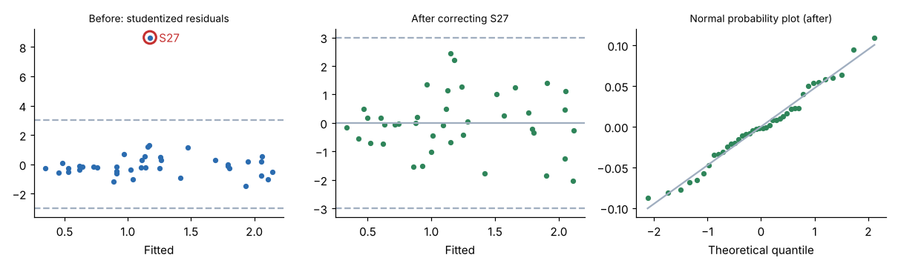
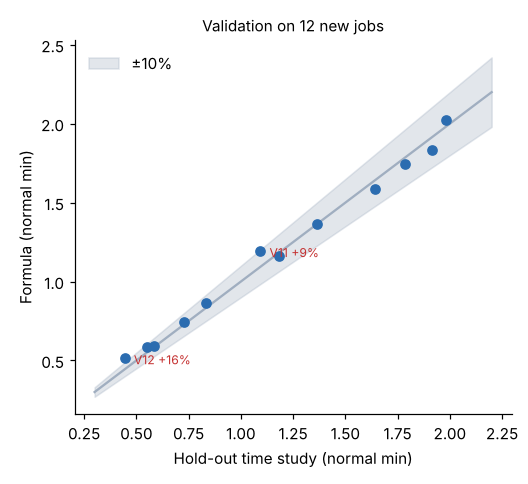

# Module 08 — Evaluating Models

## Objectives

- Use residual analysis to check the assumptions and find bad studies.
- Distinguish confidence intervals from prediction intervals, and recognize hidden extrapolation.
- Validate a model on new studies and judge it against an accuracy target.

## The evaluation checklist

| Check | Tool | Pass condition |
|---|---|---|
| Fit | R², SE of estimate | SE small compared with typical job times |
| Each term | t / p, sign, size | Significant and physically sensible |
| Outliers and influence | Studentized residuals, Cook's distance | No \|residual\| > 3; no study dominates the fit |
| Linearity, constant variance | Residuals vs fitted | No curve or funnel shape |
| Normality | Normal probability plot | Roughly straight |
| Range | Min and max of each variable, and combinations | New jobs fall inside |
| Prediction accuracy | Hold-out studies | Meets the agreed target per job and in aggregate |

## Finding the bad study

On the **first** fit of M4 (before any correction):

| | Before | After correcting S27 |
|---|---|---|
| R² | 0.976 | 0.9926 |
| SE of estimate | 0.087 min | 0.049 min |
| Largest studentized residual | **8.6** (S27) | 2.4 |
| Largest Cook's distance | 0.47 (S27) | 0.19 |



Study S27 is 8.6 standard errors from the line. The study file shows **8 bends**, but the database says **3**: a keying error. Correcting it cuts the SE almost in half.

Rules for outliers:

- **Investigate** every \|studentized residual\| > 3 against the original study file.
- **Correct** errors you can prove (keying, wrong part number, wrong element boundaries).
- **Exclude** a study only for a documented reason (foreign element, different method). Record why.
- **Never** delete a point just because it doesn't fit. That hides a missing variable or a real method difference.

## Assumption checks after the fix

| Check | Result |
|---|---|
| Residuals vs fitted | Random band, no curve, no funnel |
| Shapiro-Wilk normality | p = 0.68, no evidence of non-normality |
| Breusch-Pagan constant variance | p = 0.27, no evidence of a funnel |

If the scatter grew with job size (a funnel), you could model log time, or use weighted least squares, so that small jobs aren't predicted with large absolute errors.

## Confidence vs prediction intervals

For the 4-bend, 1-flip, 1.2 kg, 400 mm part, the fit is **0.702 min**:

- **Confidence interval** for the *average* of all such parts: 0.673 – 0.732 min. This is narrow.
- **Prediction interval** for *one* new study of such a part: **0.599 – 0.806 min**. This is wider, because it includes study-to-study scatter.

Standards are set for individual jobs, so the prediction interval is the honest measure of a standard's uncertainty. As a rough guide, the 95 % prediction interval is about ±2 SE (±0.10 min here) near the centre of the data. It widens toward the edges.

## Hidden extrapolation

Each variable can be inside its own range while the **combination** is not. The studies include 12-bend parts and 29 kg parts, but none that are both. For 12 bends, 6 flips, 29 kg and 2.3 m, the standard error of the mean prediction is **0.029 min**, compared with **0.008** for a typical part (6 bends, 2 flips, 7 kg, 1.35 m). The model is three to four times less certain there.

Before you trust a prediction for an unusual job, check how far it is from the bulk of the studies: plot the job against the study data, or look at the standard error of its prediction.

## Validation on new jobs

The real test is jobs the model has **never seen**. Harlan time-studied 12 new jobs after building the model (`data/validation_studies.csv`):



| Measure | Result |
|---|---|
| Mean absolute error per job | **4.4 %** |
| Jobs within ±5 % | 9 of 12 |
| Jobs within ±10 % | 11 of 12 |
| Worst job | V12, **+16.0 %** (1 bend, 0.44 min) |
| Aggregate error, all 12 jobs | **+0.7 %** |

The largest percentage errors are on the **shortest** jobs. A 0.07 min miss is 16 % of a 0.44 min job but only 4 % of a 1.8 min job.

Two notes on the hold-out set:

- V01 (0.37 kg) is below the studied weight range, and V10 (2,330 mm) is just above the studied length range. Both are within ±6 %, but they should still have been flagged.
- Agree the **accuracy target** with the users before validating. A common form is "±X % per job at a stated confidence, and ±Y % for a period's total". There is no universal number. Tighter targets need more studies and more variables.

If validation fails, find out why before refitting. Is it a method difference, a missing variable, or an edge of the range? Then add the hold-out studies to the data and refit.

## Run it

```bash
python tools/sdskit.py evaluate
python tools/sdskit.py validate
```

## Check yourself

1. Why does the prediction interval matter more than R² to a planner?
2. A residual of +3.4 SE belongs to a study whose notes say "new operator, first day". What do you do?
3. Harlan's target is "±10 % per job for jobs over 0.5 min, ±3 % on any week's total". Does the model pass on the hold-out set?

<details><summary>Answers</summary>

1. The planner uses one job's standard, and the prediction interval says how far one job can be from it: here about ±0.10 min. R² describes the fit to past data in general.
2. Check the rating and the study. A first-day operator is not a qualified worker at a steady pace, so the study doesn't meet the definition of a standard-setting study. Exclude it with that documented reason, rather than because it is an outlier.
3. Jobs over 0.5 min: 11 jobs (all except V12). Errors range from −4.3 % to +9.2 %, all within ±10 %. Aggregate +0.7 %. **It passes.** V12 (0.44 min, +16 %) is below the 0.5 min threshold, which is why such targets often use an absolute limit for short jobs.

</details>
