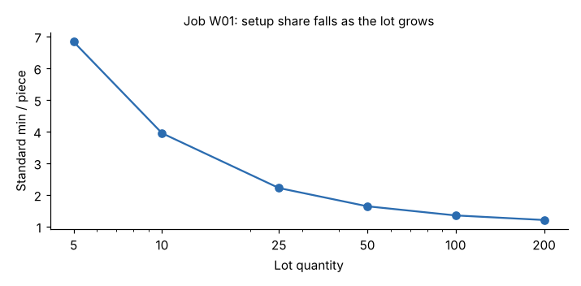

# Module 09 — Applying Standard Data

## Objectives

- Set standards, quotes and capacity loads from the data system.
- Use standards to report performance and find problems.
- Set up controls to keep the data accurate over time.

## Delivery formats

| Format | Best for | Watch out for |
|---|---|---|
| **Data sheet** (codes, values, frequencies) | IEs and auditors | Manual adding errors |
| **Lookup table** (e.g. standard min by bends × weight class) | Shop-floor and planner use without a calculator | Coarse classes lose accuracy |
| **Formula in a calculator or spreadsheet** | Estimators | Version control; copies drift |
| **Formula in the ERP routing** | Automatic standards for every new item | Inputs (bends, flips) must exist as item attributes |
| **Nomogram or chart** | Quick visual estimates | Hard to update |

Harlan's calculator is `templates/standard-data-workbook.xlsx`, sheet **JobStandard**. It computes setup, run, lot hours and cost, and **flags jobs outside the study range**.

## Use 1: quoting

Job W01 (part HF-71861: 5 bends, 1 flip, 3.85 kg, 2,230 mm; 7 tool segments; existing program; 25 pieces):

| Item | Value |
|---|---|
| Run | 0.948 normal min/piece |
| Setup | 25.77 normal min |
| Lot standard | (25.77 + 25 × 0.948) × 1.12 / 60 = **0.923 h** |
| Cost at $68 per standard hour | **$62.76**, i.e. **$2.51/piece** |

Standard minutes per piece depend strongly on lot size because setup is spread over the lot:

| Lot | 5 | 10 | 25 | 50 | 100 | 200 |
|---|---|---|---|---|---|---|
| Std min/piece | 6.83 | 3.95 | 2.22 | 1.64 | 1.35 | 1.21 |



Quote setup separately, or price by lot-size bracket. A single per-piece price set at a lot of 100 would lose money on lots of 10.

## Use 2: capacity planning

The week's 30 jobs (`data/week_jobs.csv`) need **49.91 standard hours** of brake time.

Capacity is 2 brakes × 1 shift × 7.5 h × 5 days × 85 % planned utilization = **63.75 h**, so the load is **78 %**. Setup is **26 %** of the standard hours. Setup reduction would free capacity before a second shift is needed.

## Use 3: performance and problem finding

Actual clocked hours were **55.49**, so efficiency is 49.91 / 55.49 = **89.9 %**. Two jobs stand out:

| Job | Qty | Std h | Actual h | Efficiency |
|---|---|---|---|---|
| W25 | 40 | 1.31 | 1.80 | 72.7 % |
| W28 | 200 | 5.75 | 7.64 | 75.3 % |

A low efficiency is a **question, not a verdict**. Possible answers include:

- a method difference
- missing material or a waiting operator
- a feature the data doesn't cover
- a wrong input (bends, flips)
- an actual-hours booking error

Investigate before blaming anyone. If the same feature keeps causing gaps, it may be a missing variable.

## Range checks before use

Three of the week's jobs fall outside the studied range:

| Job | Issue |
|---|---|
| W02 | 2,340 mm, just above the 2,300 mm maximum |
| W16 | 2,330 mm, just above the maximum |
| W15 | 0.27 kg, below the 0.64 kg minimum |

These are small extrapolations. Set provisional standards from the formula and add the first lot of each to the study file. Treat larger extrapolations, or a different method, as new studies.

## Keeping the data alive

| Control | How |
|---|---|
| **Ownership** | One named owner for each data family (e.g. press brake) |
| **Change control** | New machines, tooling, layouts or methods trigger a review of the affected elements |
| **Audit studies** | Time-study a sample of jobs each quarter (Harlan: 6) and compare with the formula; track the error the same way as in Module 08 |
| **Feedback** | Investigate jobs with efficiency persistently outside about 85–115 %; recurring causes become new variables or method fixes |
| **Refit** | Add audit studies to the data; refit yearly or when the audit error drifts |
| **Versioning** | Data sheet version, date, studies used, approver; standards record which version set them |
| **Training** | At least two people can maintain the model and explain it to planners and the shop floor |

## Standards and improvement

Standard data describes **the method as it is now**. When a kaizen event cuts flips with a better bend sequence, the data should change *and* the improvement shows up in quotes and capacity straight away. Used this way, standard data supports Lean: it measures the effect of method changes, and it isn't a target to defend.

## Run it

```bash
python tools/sdskit.py apply
```

## Check yourself

1. Quote W01 at a lot of 100. What is the cost per piece?
2. Next week's load is 70 standard hours. What are your options?
3. The quarterly audit of 6 jobs averages +9 % (formula higher than study) on every job. What does that pattern suggest?

<details><summary>Answers</summary>

1. (25.77 + 100 × 0.948) × 1.12 / 60 = **2.250 h** → × $68 ≈ **$153**, which is **$1.53/piece** (vs $2.51 at 25 pieces).
2. 70 / 63.75 = 110 % of capacity. Options include overtime or a partial second shift, moving work to another week, combining lots that share tooling to cut setups, and reducing setup times. Check first that the load uses current, in-range standards.
3. A **systematic** bias (all in one direction) suggests that the method or the equipment has improved since the data was built, for example a faster ram or better tooling. Find the change, update the affected elements and refit. Random scatter would look different: errors of mixed signs.

</details>
