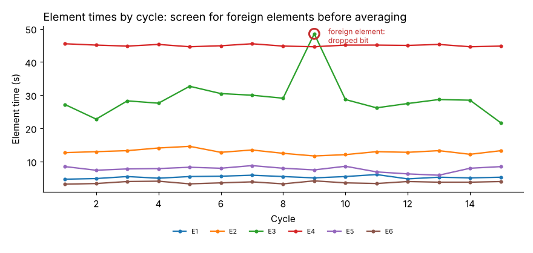

# Module 05 — Measuring Work: The Classical Method and Elemental Analysis

## Objectives

- Carry out a stopwatch (or video) time study step by step.
- Convert continuous readings to element times and screen out foreign elements.
- Determine the number of cycles needed for a stated accuracy.

## Equipment

Decimal-minute or seconds stopwatch, or a timing app/tablet, or video with a time stamp; study board and forms (`templates/time-study-form.csv`); measuring tape for the layout sketch. Video is increasingly common: it allows replay, shorter elements and rating review — but tell people they are being filmed and why, and follow company policy.

## Procedure

1. Get supervisor and operator agreement; explain purpose.
2. Confirm the method matches the documented method; sketch the workplace.
3. Record elements and breakpoints (Module 04).
4. Time a number of cycles (**continuous** timing — the watch runs throughout — or **snapback** — reset after each element).
5. Rate the operator's performance on each manual element (Module 06).
6. Note anything unusual (foreign elements, interruptions).
7. Compute normal and standard time (Module 08).

**Continuous timing** is preferred: nothing is lost between elements, and foreign elements and delays stay visible. Element times = differences between successive readings.

## Marlow: 15-cycle continuous study

`data/time_study_continuous.csv` holds cumulative readings. Subtracting gives element times:



In cycle 9, E3 took 48.5 s instead of about 28 s — the operator dropped the driver bit and replaced it. That is a **foreign element** (not part of the method). Remove it from the element average (it may count toward a delay allowance if it recurs, Module 07).

| Element | Cycles used | Mean observed (s) | SD (s) |
|---|---|---|---|
| E1 | 15 | 5.32 | 0.39 |
| E2 | 15 | 12.99 | 0.75 |
| E3 | 14 | 27.81 | 2.86 |
| E4 (machine) | 15 | 45.00 | 0.31 |
| E5 | 15 | 7.76 | 0.84 |
| E6 | 15 | 3.71 | 0.33 |

**Outlier screening:** don't delete values just because they're large. Remove only elements with a known, recorded cause that is not part of the method; investigate the rest.

## How many cycles?

For an element mean accurate to within ±k (as a fraction) at a given confidence:

n = (z · s / (k · x̄))²

(Using t with n − 1 degrees of freedom instead of z is slightly more conservative for small pilot samples.)

±5 %, 95 % confidence:

| Element | Mean | SD | Cycles needed (z) | (t) | Taken |
|---|---|---|---|---|---|
| E1 | 5.32 | 0.39 | 9 | 11 | 15 ✓ |
| E2 | 12.99 | 0.75 | 6 | 7 | 15 ✓ |
| E3 | 27.81 | 2.86 | 17 | 20 | **14 ✗** |
| E4 | 45.00 | 0.31 | 1 | 1 | 15 ✓ |
| E5 | 7.76 | 0.84 | 19 | 22 | **15 ✗** |
| E6 | 3.71 | 0.33 | 13 | 15 | 15 ✓ |

E3 and E5 are the most variable elements and need **5–8 more cycles** before the standard meets the ±5 % target. Their variability is also a methods signal: screw running (E3) and visual inspection (E5) are where the method is least consistent.

Many organizations also use rule-of-thumb tables of cycles by cycle time and annual volume; the formula is preferred when variability is known.

## Run it

```bash
python tools/wmkit.py timestudy
python tools/wmkit.py cycles
```

## Check yourself

1. Why is continuous timing preferred over snapback?
2. An element has mean 10 s and SD 1.5 s. How many cycles for ±5 % at 95 %?
3. What would you do about E5's variability besides taking more cycles?

<details><summary>Answers</summary>

1. No time is lost between readings, the total cycle is preserved, and delays and foreign elements are captured instead of hidden.
2. (1.96 × 1.5 / 0.5)² = 34.6 → 35 cycles.
3. Look at the method: inconsistent inspection steps — a defined inspection sequence, better lighting or a fixture/limit sample would reduce variation (and improve quality).

</details>
