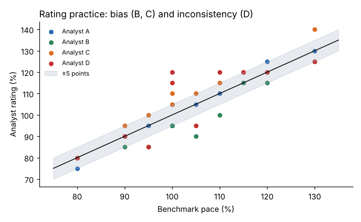

# Module 06 — Rating (Performance Rating)

## Objectives

- Explain why observed times must be adjusted for the operator's pace.
- Apply pace rating and describe other rating systems.
- Measure and improve rating consistency through training.

## Why rate?

The observed operator may work faster or slower than **normal pace** — the pace a qualified worker can sustain over a shift without undue fatigue. Rating converts observed time to **normal time**:

Normal time = observed time × rating / 100

A rating of 110 % means the operator worked 10 % faster than normal, so normal time is longer than observed. At Marlow the operator was rated **110 %** on manual elements; the machine element (leak test) is rated **100 %** because the operator can't change it.

## Benchmarks of normal pace

Organizations define normal pace with benchmarks — for example, a commonly cited benchmark is walking at about 3 miles per hour (4.8 km/h) on level ground without load, or dealing a deck of 52 cards into four piles in about half a minute. Benchmarks vary by source; **document the one you use** in the standard practice.

## Rating systems

| System | How | Notes |
|---|---|---|
| **Pace (speed) rating** | one percentage judging speed against normal pace | most common; needs trained, calibrated analysts |
| **Leveling (e.g. Westinghouse system)** | adds factors for skill, effort, conditions and consistency | four judgments instead of one; factor tables vary by source |
| **Synthetic rating** | compares observed element times with PMTS times for the same elements | ties rating to an objective reference for some elements |
| **Objective rating** | pace rating combined with a job-difficulty adjustment | less common |

Leveling example (illustrative factor values): skill "good" +0.06, effort "good" +0.05, conditions "average" 0, consistency "good" +0.01 → leveling factor **1.12** (i.e. rating 112 %). Check the factor values in your chosen reference.

## Rating good practice

- Rate **each element** (or each cycle) while observing — not afterwards from memory.
- Rate only **manual** elements; machine-controlled elements are 100 %.
- Avoid studying operators far from normal pace (very slow learners or unusually fast experts) — rating accuracy drops at the extremes.
- Rating must not depend on the analyst's expectation of the result.

## Rating training and calibration

Analysts rate film or video clips of known benchmark pace and compare. Marlow's four analysts, 10 clips each (`data/rating_practice.csv`):

| Analyst | Mean error (points) | SD of error | Within ±5 points |
|---|---|---|---|
| A | 0.0 | 3.3 | 100 % |
| B | **−6.0** | 4.6 | 70 % |
| C | **+5.0** | 3.3 | 80 % |
| D | +2.5 | **10.1** | 50 % |



- **B** consistently rates low (standards would be tight) — a **bias**, fixable by recalibration.
- **C** consistently rates high (loose standards).
- **D** is **inconsistent** — the harder problem; more training before D sets standards.

A common goal is to rate within about ±5 points of the benchmark. Repeat calibration periodically and whenever new analysts join.

## Run it

```bash
python tools/wmkit.py rating
```

## Check yourself

1. Observed mean 20 s, rating 90 %. Normal time?
2. Why is analyst B's bias easier to fix than analyst D's inconsistency?
3. Why not rate the leak test?

<details><summary>Answers</summary>

1. 20 × 0.90 = 18 s.
2. A consistent bias can be corrected by calibration (the analyst learns to shift their judgment); random inconsistency needs repeated practice and feedback.
3. Its duration is set by the machine, not the operator's effort or skill.

</details>
