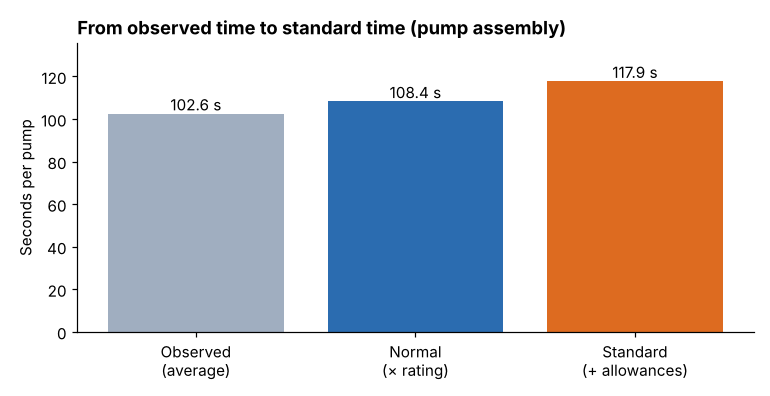

# Module 08 — Computations, Time Study Methods and Practices

## Objectives

- Compute normal time and standard time from a time study.
- Express standards in useful units (minutes per piece, pieces per hour, hours per 100).
- Apply good practice in conducting, communicating and maintaining time studies.

## The computation

For each element:

1. **Observed time** = mean of valid readings.
2. **Normal time** = observed × rating / 100.
3. Add **occasional elements** pro-rated by frequency (e.g. tote exchange time ÷ 20).

Then:

4. **Normal time per unit** = sum of element normal times.
5. **Standard time** = normal time with allowances (Module 07).

## Marlow pump assembly

| Element | Type | Cycles | Mean observed (s) | Rating | Normal (s) |
|---|---|---|---|---|---|
| E1 | manual | 15 | 5.32 | 110 % | 5.85 |
| E2 | manual | 15 | 12.99 | 110 % | 14.29 |
| E3 | manual | 14 | 27.81 | 110 % | 30.60 |
| E4 | machine | 15 | 45.00 | 100 % | 45.00 |
| E5 | manual | 15 | 7.76 | 110 % | 8.54 |
| E6 | manual | 15 | 3.71 | 110 % | 4.08 |
| **Total** | | | | | **108.36** |

Standard time (15 % PF&D on manual elements only): 63.36 × 1.15 + 45.00 = **117.86 s = 1.964 min per pump**.



| Expression | Value |
|---|---|
| Standard minutes per pump | 1.964 |
| Pumps per hour at standard | 30.5 |
| Pumps per 7.5-hour shift | 229 |
| Standard hours per 100 pumps | 3.27 |

(With the improved method from Module 03 — assembling during the leak test — the standard would fall to about 72.9 s.)

Spreadsheet version: one row per element with observed mean (AVERAGE of valid readings), rating, normal time, a type column, and the allowance applied with an IF on the type.

## Time study practices

**Before:**
- method documented and stable; operator trained and experienced;
- union or employee representatives informed where applicable;
- operator told what is studied and why.

**During:**
- stand where you can see without interfering;
- record everything, including interruptions;
- rate continuously.

**After:**
- review the study with the supervisor (and operator where practice allows);
- issue the standard with its documentation;
- check actual performance against the standard for the first weeks — large deviations suggest a study or method problem.

**Maintenance:** re-study when method, equipment, material, product or layout change; audit standards periodically; track the age of standards (e.g. % of standards older than 2 years).

**Ethics:** work measurement depends on trust. Never time secretly, never "adjust" ratings to hit a target, and correct errors openly.

## Run it

```bash
python tools/wmkit.py timestudy
```

## Check yourself

1. Add a tote exchange: 18 s normal time every 20 pumps. New standard (manual, 15 %)?
2. Convert 1.964 min per pump to standard hours per 1,000 pumps.
3. Actual output after release runs at 140 % of standard for three weeks. What do you check?

<details><summary>Answers</summary>

1. +18 / 20 = 0.9 s normal per pump → +1.035 s standard → 118.9 s ≈ 1.98 min.
2. 1.964 × 1,000 / 60 = 32.7 h.
3. Whether the method changed (or differs from the study), counting errors, whether the study operator was rated too high, or the wrong allowance convention — then correct the standard if needed.

</details>
