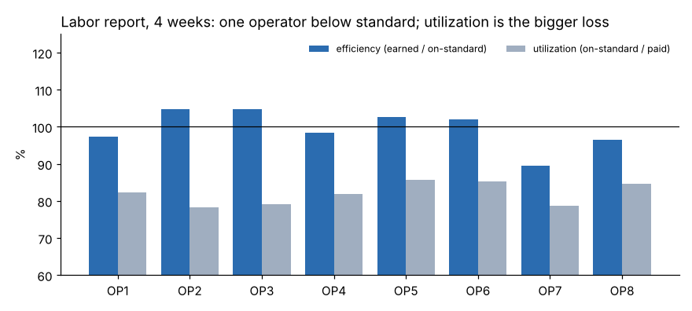

# Module 09 — Labor Reporting

## Objectives

- Calculate earned hours, efficiency, utilization and productivity.
- Separate on-standard and off-standard time and analyze off-standard causes.
- Use labor reports to improve the system, not to blame individuals.

## Definitions

| Term | Formula |
|---|---|
| Earned (standard) hours | units produced × standard hours per unit |
| Hours on standard | time worked on measured jobs |
| Hours off standard | time on unmeasured activities or delays (waiting, meetings, training, rework, machine down) |
| **Efficiency (performance)** | earned hours ÷ hours on standard |
| **Utilization** | hours on standard ÷ paid (or available) hours |
| **Productivity** | earned hours ÷ paid hours = efficiency × utilization |

Efficiency answers "how well did people work against standard when they could work?"; utilization answers "how much of their time could they work on standard jobs?"

## Marlow: 4 weeks, 8 operators

| Operator | Earned h | On-std h | Paid h | Efficiency | Utilization | Productivity |
|---|---|---|---|---|---|---|
| OP1 | 128.5 | 131.9 | 160.0 | 97.4 % | 82.4 % | 80.3 % |
| OP2 | 131.1 | 125.1 | 160.0 | 104.8 % | 78.2 % | 81.9 % |
| OP3 | 132.6 | 126.6 | 160.0 | 104.7 % | 79.1 % | 82.9 % |
| OP4 | 128.9 | 131.1 | 160.0 | 98.3 % | 81.9 % | 80.6 % |
| OP5 | 140.7 | 137.1 | 160.0 | 102.7 % | 85.7 % | 88.0 % |
| OP6 | 139.3 | 136.5 | 160.0 | 102.1 % | 85.3 % | 87.1 % |
| OP7 | 112.7 | 125.9 | 160.0 | **89.5 %** | 78.7 % | 70.4 % |
| OP8 | 130.6 | 135.3 | 160.0 | 96.5 % | 84.6 % | 81.6 % |
| **Department** | | | | **99.5 %** | **82.0 %** | **81.6 %** |



**Off-standard hours by reason (4 weeks):** waiting for parts 66.0 · meetings 64.2 · machine down 44.2 · training 42.6 · rework 13.5 — about **230 hours**, 18 % of paid time.

**Reading the report:**

- The department works at standard (99.5 %) when it can work; the bigger loss is **utilization** (82 %). Waiting for parts and machine downtime (110 hours) are system problems — a materials and maintenance conversation, not a people conversation.
- **OP7** is about 10 % below standard. First questions: is OP7 new (learning curve, Module 13)? On a different job mix? Is the method or equipment at that station different? Coaching comes after the system checks.

## Reporting practice

- Report weekly; trend over time.
- Require a reason code for every off-standard hour; Pareto them.
- Keep efficiency and utilization separate — combining them hides where the loss is.
- Don't use labor reports in isolation for discipline; standards that are perceived as weapons stop being reported honestly.
- Watch for **gaming**: reporting off-standard time as on-standard (or the reverse) distorts both measures.

## Run it

```bash
python tools/wmkit.py labor
```

## Check yourself

1. Earned 35 h, on-standard 38 h, paid 40 h. Efficiency, utilization, productivity?
2. Department efficiency rises from 95 % to 110 % in one month without changes. What might explain it?

<details><summary>Answers</summary>

1. Efficiency 92.1 %, utilization 95 %, productivity 87.5 %.
2. Loose standards on a new product mix, method improvements not reflected in standards, counting errors, or off-standard time reported as on-standard (reducing the denominator). Investigate before celebrating.

</details>
