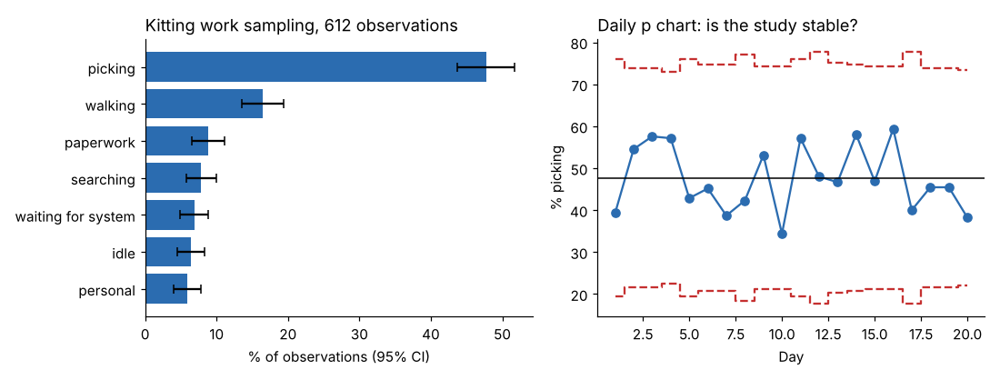

# Module 11 — Work Sampling

## Objectives

- Plan and conduct a work sampling study.
- Calculate proportions, confidence intervals and required sample sizes.
- Check study stability with a control chart, and set a standard from work sampling.

## Principle

Make many **random, instantaneous observations** and record what each person is doing. The share of observations in a category estimates the share of time spent in it. Good for long, irregular, group or non-repetitive work, and for measuring delays and allowances.

## Planning

1. Define the purpose and the **activity categories** (mutually exclusive, observable at a glance).
2. Decide the accuracy needed → number of observations.
3. Schedule **random observation times** over enough days to cover normal variation.
4. Explain the study to the people observed.
5. Observe at the exact random moment; record the first thing seen.
6. Check stability (control chart); compute results.

## Marlow kitting study

3 kitters, 20 days, **612 random observations** (`data/work_sampling_kitting.csv`):

| Activity | Share | 95 % CI |
|---|---|---|
| Picking | 47.7 % | 43.8–51.7 % |
| Walking | 16.5 % | 13.6–19.4 % |
| Paperwork / scanning | 8.8 % | 6.6–11.1 % |
| Searching | 7.8 % | 5.7–10.0 % |
| Waiting for system | 6.9 % | 4.9–8.9 % |
| Idle | 6.4 % | 4.4–8.3 % |
| Personal | 5.9 % | 4.0–7.7 % |

CI half-width = 1.96 × √[p(1 − p)/n].



**Sample size** to estimate picking within ±3 points (95 %): n = 1.96² × 0.477 × 0.523 / 0.03² = **1,065** observations — the study needs about 450 more.

**Stability:** a daily p chart of the picking share shows no days outside limits — the process was stable over the study, so the overall proportions are meaningful.

**Findings:** walking + searching = **24 %** of kitter time — a layout and location-system problem; waiting for the system 7 % — an IT issue. Together that's nearly a third of the time.

## Setting a standard from work sampling

Standard time per unit = (total time × share of time on the task × rating ÷ units produced) × (1 + allowance)

Marlow kitting, 20 days: 28,800 kitter-minutes; 11,963 kits; rating 100 %; allowance 12 %:

| Basis | Share of time | Standard min per kit |
|---|---|---|
| Current method (picking + walking + searching + paperwork) | 80.9 % | **2.181** |
| If walking and searching are removed (picking + paperwork) | 56.6 % | 1.524 |

The current-method standard includes method waste; it is valid **for the current method** and should be revised after the layout improvement. (Assumes average rating of 100 %; rating during sampling, or confirming with short time studies, improves accuracy.)

## Run it

```bash
python tools/wmkit.py sampling
python tools/wmkit.py sampling_std
```

## Check yourself

1. 900 observations, 18 % idle. 95 % CI?
2. Why must observation times be random?
3. Why does the work-sampling standard include walking and searching?

<details><summary>Answers</summary>

1. 1.96 × √(0.18 × 0.82 / 900) = ±2.5 points → 15.5–20.5 %.
2. Fixed times could coincide with periodic activities (breaks, batch cycles) and people may anticipate them, biasing the result.
3. Because they're part of the current method; a standard must reflect the method actually used. Remove them from the method first, then update the standard.

</details>
