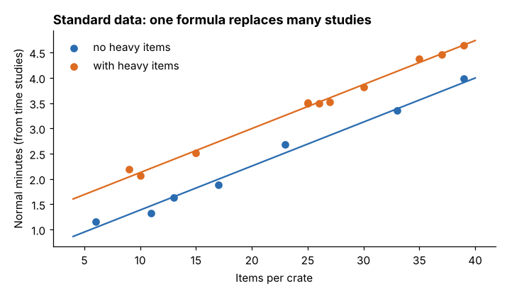

# Module 12 — Standard Data and Related Methods

## Objectives

- Build standard data (element tables and formulas) from past studies.
- Use regression to develop and validate a standard-data formula.
- Describe predetermined motion time systems and other related methods.

## Standard data

**Standard data** are element times (or formulas) organized so standards for new jobs can be built without a new time study. They come from many past studies of similar work:

- **Constant elements** — a table value (e.g. "get housing, place in fixture: 5.9 s normal").
- **Variable elements** — a formula or curve in terms of the variable that drives time (count, size, distance, weight).

Advantages: fast and consistent standards for new parts; standards before production starts; fewer studies. Requirements: enough good studies, a consistent method and element definitions, and validation.

## Marlow: crate pack-out formula

18 past time studies of pack-out (`data/packout_studies.csv`) — normal minutes vs items per crate and whether the crate contains heavy items:

Normal minutes = **0.516 + 0.087 × items + 0.741 × (heavy items present)**

R² = 0.993; residual SD 0.095 min; valid for 6–39 items.



New crate: 24 items including heavy ones → **3.35 normal minutes** (95 % prediction interval 3.14–3.56) → **3.85 standard minutes** with 15 % allowance — no new study needed.

Rules for using a formula: stay within the range of the data; check the method matches; spot-check new standards with a short study; refit when methods change.

## Predetermined motion time systems (PMTS)

PMTS assign times to basic human motions (reach, grasp, move, position, release, body motions) based on their characteristics (distance, weight, difficulty). Summing the motions in a method gives normal time **without a stopwatch and without rating**.

- Useful for designing and comparing methods **before** the job exists, and for short-cycle work.
- Common systems include MTM (Methods-Time Measurement) and its derivatives, and MOST (Maynard Operation Sequence Technique) — these are proprietary or licensed systems that require trained, certified analysts. Times use units such as TMU (time measurement unit; 1 TMU = 0.00001 hour = 0.036 s).
- Allowances are still added to get standard time.

## Other related methods

| Method | Use |
|---|---|
| Historical data | rough estimates; contaminated by past delays and methods |
| Estimating by comparison (slotting) | place a job between benchmark jobs with known standards |
| Video and digital time study | replay, frame-level element timing, rating review |
| Sensor / system data | cycle times from machines or scanners — good for machine-paced work, check against method |

## Run it

```bash
python tools/wmkit.py standard_data
```

## Check yourself

1. Compute the normal time for a 10-item crate with no heavy items.
2. Why not use the formula for a 60-item crate?
3. When would you choose PMTS over a stopwatch study?

<details><summary>Answers</summary>

1. 0.516 + 0.087 × 10 = 1.386 ≈ 1.39 min.
2. It's outside the 6–39-item range of the data; the relationship may change (e.g. a second layer, extra handling).
3. When the job doesn't exist yet, the cycle is very short, or you need to compare alternative methods on paper.

</details>
