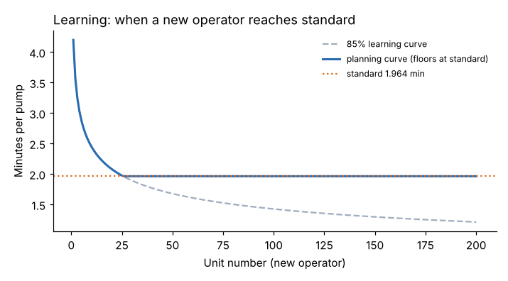

# Module 13 — Applying Work Measurement Data, and Capstone

## Objectives

- Use standards for staffing, capacity and takt planning.
- Apply learning curves to new operators and new products.
- Integrate the course in a capstone exercise.

## Staffing and capacity

Operators needed = demand × standard time ÷ (available time per operator × planned efficiency)

Marlow pump assembly: 4,200 pumps/week; standard 1.964 min; 450 productive minutes per shift; 5 days; planned efficiency 95 %.

- Operator-minutes needed: 4,200 × 1.964 = **8,249**
- Per operator per week: 5 × 450 = 2,250 min × 0.95 = 2,137.5
- Operators: 8,249 ÷ 2,137.5 = **3.86 → 4 operators** (2 per shift)
- **Takt time** over two shifts: (5 × 2 × 450 × 60) ÷ 4,200 = **64.3 s** per pump. With 2 operators per shift each building complete pumps, the cell produces one pump about every 117.9 ÷ 2 = 59 s — inside takt. The leak tester (45 s per pump) is also within takt.

With the improved method (Module 03: 72.9 s standard), the same demand needs about **2.4 operators** — 1.5 fewer people for the same output, or capacity for growth.

## Learning curves

New operators (and new products) start slower. On an 85 % learning curve, each doubling of cumulative units cuts the unit time to 85 % of its previous value:

Tₙ = T₁ × n^b, with b = log(0.85) / log(2) = −0.2345

New Marlow operator, first pump 4.20 min:

| Unit | 1 | 2 | 4 | 8 | 16 | 32 |
|---|---|---|---|---|---|---|
| Minutes | 4.20 | 3.57 | 3.03 | 2.58 | 2.19 | 1.86 |

The curve reaches the 1.964-min standard at about **unit 26**. After that, **plan at the standard** — don't extrapolate the curve below it (a pure curve would predict 1.21 min at unit 200, faster than the method allows). Planning minutes for a new operator's first 100 pumps: **209.5** (vs 196.4 at standard).

Uses: training plans, start-up staffing, quoting new products, and interpreting a new operator's efficiency on the labor report (Module 09).

## Capstone

Using a job you know (or the Marlow data):

1. **Document** the method (process chart, workplace sketch) and **improve** it (ECRS) — Modules 02–03.
2. **Define** elements with breakpoints and types — Module 04.
3. **Time** at least 10–15 cycles; screen foreign elements; check the number of cycles — Module 05.
4. **Rate** each manual element; record the basis — Module 06.
5. **Apply** documented allowances — Module 07.
6. **Compute** the standard and express it in several units; prepare the study file — Module 08.
7. **Use** it: staffing for a demand level, takt check, and a labor-report KPI — Modules 09, 13.
8. **Sample** a related indirect job (at least 200 observations) and estimate delay shares — Module 11.

**Review criteria:** method documented and stable before timing; cycles sufficient for ±5 %; rating and allowances justified and documented; computation correct; results applied to a real decision.

## Skill check

1. Observed 30 s, rating 105 %, allowance 15 % of normal time. Standard?
2. Element mean 8 s, SD 1.2 s. Cycles for ±5 % at 95 %?
3. Earned 152 h, on-standard 160 h, paid 180 h. Efficiency and utilization?
4. 500 observations, 12 % waiting. 95 % CI?
5. Demand 2,000 units/week, standard 3.0 min, 2,250 min per operator, 95 % planned efficiency. Operators?
6. 80 % learning curve, unit 1 = 10 min. Unit 8?

Answers

1. 30 × 1.05 = 31.5 s normal → 31.5 × 1.15 = 36.2 s.
2. (1.96 × 1.2 / 0.4)² = 34.6 → 35.
3. Efficiency 95.0 %; utilization 88.9 %.
4. 1.96 × √(0.12 × 0.88 / 500) = ±2.8 points → 9.2–14.8 %.
5. 6,000 / (2,250 × 0.95) = 2.81 → 3 operators.
6. 10 × 0.8³ = 5.12 min.

